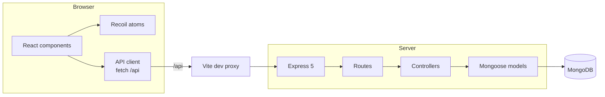

# Keynan

**A minimal flashcard app for building decks and retaining what's in them.**

Keynan keeps the study loop short: flip a card, recall the answer, mark it as **Got It** or **Still Learning**, and see where you stand. Decks live in MongoDB and are served through a small REST API, so what you build is there the next time you open the app.

## Table of contents

- [Features](#features)
- [Architecture](#architecture)
- [Tech stack](#tech-stack)
- [Getting started](#getting-started)
- [Configuration](#configuration)
- [Scripts](#scripts)
- [API reference](#api-reference)
- [Project structure](#project-structure)
- [Design notes](#design-notes)
- [Contributing](#contributing)

## Features

- **Study mode:** flip a card to reveal its answer and description.
- **Progress tracking:** mark each card as *Got It* or *Still Learning* and watch the counts update live.
- **Session summary:** finish a deck to see a completion score, or reset and go again.
- **Deck browser:** browse decks from the backend with card counts and last-updated times.
- **Card creation:** add new flashcards from a modal without leaving the study view.
- **REST API:** deck and card endpoints backed by MongoDB and Mongoose.

## Architecture



**Request flow.** The client calls relative `/api` paths. In development, Vite proxies those requests to the Express server. A request passes through a route, then a controller, then a Mongoose model, and the response is returned as JSON.

**Client state.** Recoil holds the active deck, the study session, and per-card progress. Components subscribe to atoms in `src/store`.

**Data model.** A deck is a MongoDB document. Its cards are embedded subdocuments, so a deck and its cards are read and written together.

## Tech stack

| Layer | Technology |
| --- | --- |
| UI | React 18, JavaScript (JSX), Tailwind CSS 4, Poppins |
| State | Recoil |
| Build tooling | Vite 8, npm, Oxlint |
| Server | Node.js, Express 5, CORS, dotenv |
| Database | MongoDB, Mongoose 9 |

## Getting started

### Prerequisites

- Node.js (current LTS) and npm
- A MongoDB instance, either local or hosted (for example MongoDB Atlas)

To run MongoDB locally with Docker:

```sh
docker run -d --name keynan-mongo -p 27017:27017 mongo:7
```

### 1. Install dependencies

From the repository root:

```sh
npm install
cd src/server && npm install
```

### 2. Configure the backend

Create `src/server/.env`:

```env
MONGODB_URI=mongodb://127.0.0.1:27017/keynan
PORT=5001
```

### 3. Run the backend

```sh
cd src/server
npm start
```

### 4. Run the frontend

In a second terminal, from the repository root:

```sh
npm run dev -- --port 5174 --strictPort
```

Open the URL Vite prints. Requests to `/api` are proxied to `http://localhost:5001`, as set in `vite.config.js`.

## Configuration

| Variable | Location | Description | Example |
| --- | --- | --- | --- |
| `MONGODB_URI` | `src/server/.env` | MongoDB connection string | `mongodb://127.0.0.1:27017/keynan` |
| `PORT` | `src/server/.env` | Port the Express server listens on. Keep it in sync with the proxy target in `vite.config.js`. | `5001` |

## Scripts

Run from the repository root:

| Command | Description |
| --- | --- |
| `npm run dev` | Start the Vite dev server |
| `npm run build` | Create a production build |
| `npm run preview` | Preview the production build locally |
| `npm run lint` | Lint the codebase with Oxlint |

Run from `src/server`:

| Command | Description |
| --- | --- |
| `npm start` | Start the Express server |

## API reference

The API is mounted at `/api`.

### Decks

| Method | Endpoint | Description |
| --- | --- | --- |
| `GET` | `/api/decks` | List all decks |
| `POST` | `/api/decks` | Create a deck |
| `GET` | `/api/decks/:id` | Get a deck by ID |
| `PUT` | `/api/decks/:id` | Update a deck |
| `DELETE` | `/api/decks/:id` | Delete a deck |

### Cards

| Method | Endpoint | Description |
| --- | --- | --- |
| `GET` | `/api/decks/:deckId/cards` | List the cards in a deck |
| `POST` | `/api/decks/:deckId/cards` | Add a card to a deck |
| `PUT` | `/api/decks/:deckId/cards/:id` | Update a card |
| `DELETE` | `/api/decks/:deckId/cards/:id` | Delete a card |

## Project structure

```text
.
├── vite.config.js          # Vite config and /api dev proxy
└── src/
    ├── App.jsx             # Application entry component
    ├── Data.js             # Sample deck
    ├── components/         # React UI components
    ├── store/              # Recoil atoms
    ├── controllers/        # Express request handlers
    ├── routes/             # Deck and card route definitions
    ├── middlewares/        # Authentication and validation middleware
    └── server/
        ├── server.js       # Express entry point and MongoDB connection
        ├── models/         # Mongoose schemas
        └── service/        # Frontend API client
```

## Design notes

- **Relative `/api` paths.** The client has no hard-coded backend URL. The dev proxy forwards `/api` to Express, which keeps the browser on one origin and avoids CORS friction during development.
- **Embedded cards.** Cards are subdocuments of a deck, so a deck loads in a single query and its cards always stay with it.
- **Thin controllers.** Routes map to controllers, controllers talk to models, and the client only knows the HTTP surface.

## Contributing

1. Create a branch from `main`.
2. Make your change and run `npm run lint`.
3. Open a pull request that explains what changed and why.

Keep pull requests small and focused on one change.
# keynan
